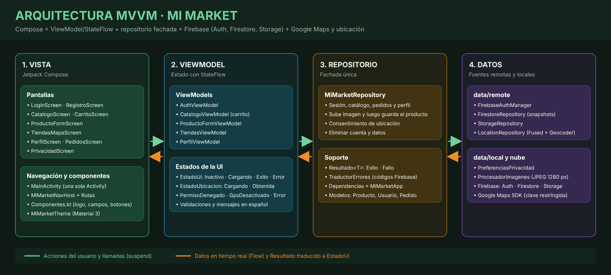

# Mi Market

App Android de compras para un minimarket, hecha con Jetpack Compose y arquitectura MVVM. Usa Firebase Authentication, Cloud Firestore, Cloud Storage, Google Maps y la ubicación del teléfono.



## Qué hace

* Registro e inicio de sesión con correo y contraseña. La sesión queda abierta hasta que el usuario la cierra.
* Catálogo en tiempo real con búsqueda, filtro por categoría y carrito.
* Formulario de producto con foto de la galería. La foto se comprime y se sube a Storage; su URL se guarda en Firestore.
* Solo el creador de un producto o un administrador puede editarlo o eliminarlo.
* Historial de pedidos en `usuarios/{uid}/pedidos`.
* Mapa de tiendas con marcadores, tienda más cercana, punto de entrega elegido en el mapa y dirección por geocodificación inversa.
* Aviso de privacidad antes de pedir la ubicación, flujo alternativo si se niega el permiso o el GPS está apagado.
* Perfil con cambio de nombre, retiro del consentimiento de ubicación, cierre de sesión y eliminación de la cuenta con todos sus datos.

## Estructura

```
app/src/main/java/com/example/retrofit/
    MiMarketApp.kt
    di/Dependencias.kt
    model/            Producto, Usuario, Pedido, Tienda, Coordenada, ItemCarrito
    data/remote/      FirebaseAuthManager, FirestoreRepository, StorageRepository, LocationRepository
    data/local/       PreferenciasPrivacidad, ProcesadorImagenes
    repository/       MiMarketRepository (fachada), Resultado, TraductorErrores
    viewmodel/        EstadoUi y un ViewModel por pantalla principal
    view/             MainActivity, navegacion/, componentes/, pantallas/
    ui/theme/         Color y MiMarketTheme
    util/             Validaciones, Formatos
firestore.rules       Reglas de Cloud Firestore
storage.rules         Reglas de Cloud Storage
docs/                 Reglas de seguridad y política de privacidad (PDF)
```

## Configuración

1. Crear un proyecto en Firebase y registrar la app Android con el paquete `com.example.retrofit` y la huella SHA-1 de depuración.
2. Descargar `google-services.json` y copiarlo en la carpeta `app/`. El archivo está en `.gitignore` y no se sube al repositorio.
3. Activar Authentication con correo y contraseña, crear Firestore y Storage, y publicar `firestore.rules` y `storage.rules`.
4. En Google Cloud habilitar "Maps SDK for Android", crear una clave restringida al paquete y al SHA-1, y agregarla en `local.properties`:

```
MAPS_API_KEY=tu_clave_de_maps
```

5. Sincronizar Gradle y ejecutar la app.

Para dar permisos de administrador a una cuenta, cambiar a mano el campo `rol` de `cliente` a `admin` en `usuarios/{uid}` desde la consola de Firestore.

## Versiones

AGP 9.2.1, Gradle 9.4.1, compileSdk 36, minSdk 24, Compose BOM 2024.10.00, Firebase BoM 34.19.0, maps-compose 6.4.1, play-services-location 21.3.0.
